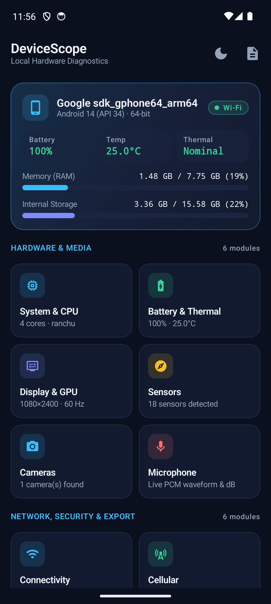
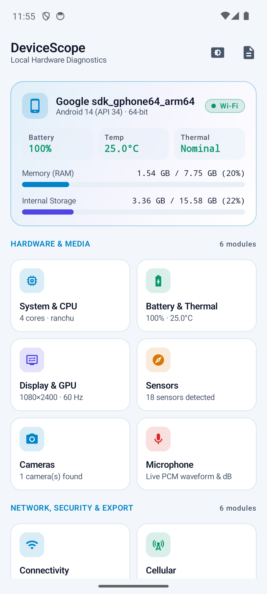
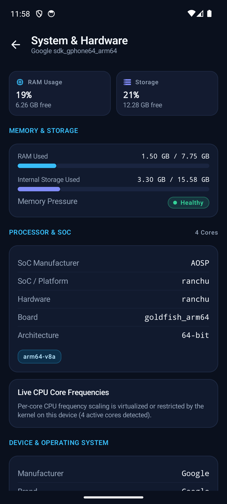
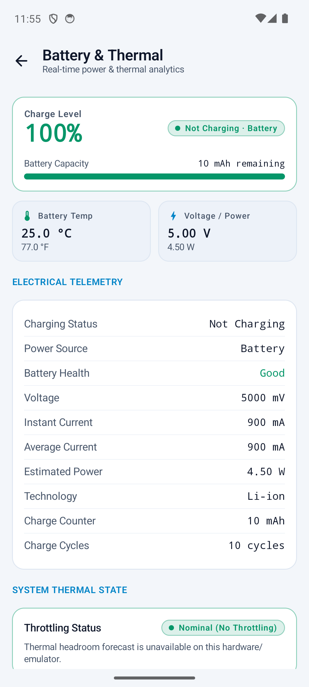
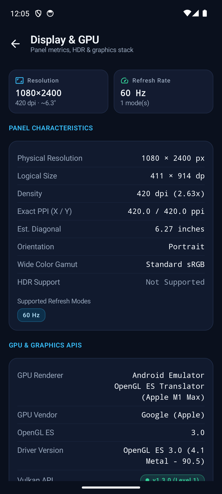
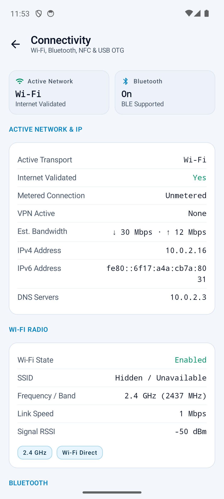
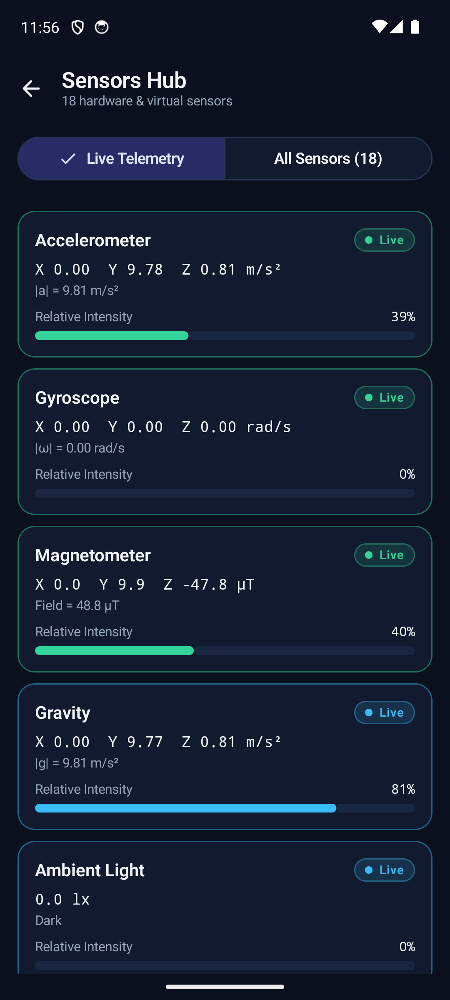
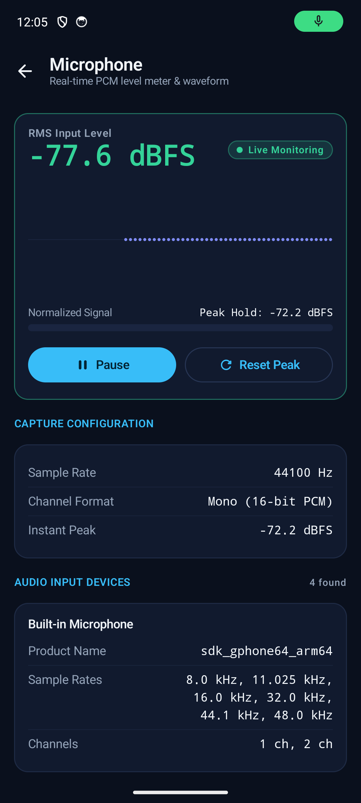
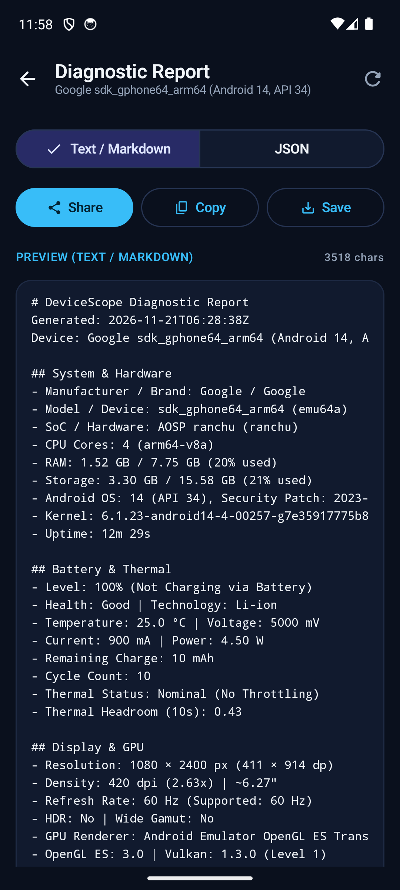

# DeviceScope

A modern, privacy-first Android hardware diagnostics and telemetry app built with **Jetpack Compose** and **Material 3**. All inspection runs 100% locally on your device — zero ads, zero tracking, zero network uploads.

## Screenshots

| Dashboard (Dark) | Dashboard (Light) | System & Hardware |
| :---: | :---: | :---: |
|  |  |  |

| Battery & Thermal | Display & GPU | Connectivity |
| :---: | :---: | :---: |
|  |  |  |

| Sensors Hub | Microphone | Diagnostic Report |
| :---: | :---: | :---: |
|  |  |  |

## Installation

1. Go to [Releases](https://github.com/Tolstoyj/DeviceScope/releases/latest)
2. Download **`DeviceScope-v2.0.0.apk`** (~2.8 MB, R8-optimized multi-ABI release build)
3. On your Android device:
   - Allow installing unknown apps from your browser/file manager if prompted
   - Open the downloaded APK and follow the installation prompts

**Requirements:**
- **Android 10 (API 29)** or higher (`targetSdk = 35`)
- ~5 MB free storage

## Features

### Hardware & Media
- **Live Vitals Dashboard:** Real-time summary of device model, Android version, active transport, battery %, temperature, thermal state, RAM usage, and internal storage with an in-app **System / Light / Dark** theme toggle.
- **System & CPU:** SoC/platform, architecture ABIs, live per-core CPU frequencies, live RAM & internal storage gauges, Android OS/security patch, kernel version, and uptime.
- **Battery & Thermal:** Charge level, charging source (AC/USB/Wireless/Dock), health, voltage (mV), instantaneous & average current (mA), estimated power (W), remaining charge counter (mAh), battery cycle count (Android 14+), Android `PowerManager` thermal throttling status, and 10s thermal headroom.
- **Display & GPU:** Physical & logical resolution, DPI/PPI, estimated diagonal size, active & supported refresh rates, HDR capabilities & wide color gamut, GPU renderer/vendor (EGL14/OpenGL ES), Vulkan API version/level, plus an interactive **Dead-Pixel & Uniformity Screen Tester**.
- **Sensors Hub:** Live real-time telemetry for Accelerometer, Gyroscope, Magnetometer, Gravity, Ambient Light, Proximity, Barometer, Humidity, Ambient Temp, and Step Counter — plus a complete **All Sensors** catalog of every hardware/virtual sensor on the device.
- **Cameras:** Camera2 hardware enumeration showing lens facing, max JPEG resolution & megapixels, hardware level, sensor dimensions, focal lengths, apertures, AE FPS ranges, physical camera IDs, and feature flags (AF, OIS, Video Stabilization, RAW, Manual Sensor, Depth).
- **Microphone:** Live 44.1 kHz 16-bit PCM capture with real-time RMS/Peak dBFS meter, Peak Hold, mirrored live waveform visualization, Pause/Resume controls, and audio input device listing.

### Network, Security & Export
- **Connectivity:** Active transport, internet validation, metered/VPN status, estimated bandwidth, IPv4/IPv6/DNS, Wi-Fi band (2.4/5/6 GHz), link speed, RSSI, Bluetooth/BLE & paired devices, NFC status, and USB Host (OTG).
- **Cellular Radio:** Modern `TelephonyCallback` (API 31+) with API 29–30 fallback for signal dBm/ASU/bars, 5G/4G/3G/2G generation & display overrides (5G NSA/mmWave/LTE-CA), voice/data status, roaming, and metering.
- **Location & GNSS:** Native `LocationManager` GPS/Network/Fused telemetry (coordinates + DMS, speed, altitude, bearing, accuracy, cumulative session distance with reset) and live GNSS visible/used satellite counts.
- **Phone & SIM:** Carrier/operator info, SIM state, multi-SIM & eSIM subscription details, and transparent Android 10+ identifier privacy notes.
- **Biometrics:** Modern AndroidX `BiometricManager` readiness (Class 3 Strong, Class 2 Weak, Device Credential), hardware flags, and an interactive `BiometricPrompt` live test with custom ripple visualization.
- **Diagnostic Report Export:** Generate a full device snapshot in **Text / Markdown** or **JSON**, preview it in-app, copy to clipboard, share via Android Share Sheet, or save directly to storage.

## Tech Stack
- **Kotlin 2.2** & **Coroutines / StateFlow**
- **Jetpack Compose** & **Material Design 3** (Adaptive Light / Dark / System themes, Edge-to-Edge)
- **Single-Activity Navigation** (`androidx.navigation:navigation-compose`)
- **AndroidX Lifecycle & ViewModel** + **AndroidX Biometric**
- **Android Hardware APIs** (Camera2, TelephonyCallback, BatteryManager, PowerManager Thermal, LocationManager/GNSS, AudioRecord, EGL14/GLES20, SensorManager, ConnectivityManager)

## Building Locally

```bash
# Run unit tests & assemble debug APK
./gradlew testDebugUnitTest assembleDebug

# Assemble R8-shrunk release APK
./gradlew assembleRelease
```

## Privacy & Permissions
All permissions (`CAMERA`, `READ_PHONE_STATE`, `READ_PHONE_NUMBERS`, `ACCESS_FINE_LOCATION`, `RECORD_AUDIO`, `BLUETOOTH_CONNECT`) are optional and requested just-in-time only on the screens that need them. Every diagnostic runs strictly on-device with no internet transmission.

## License
Apache 2.0 License
